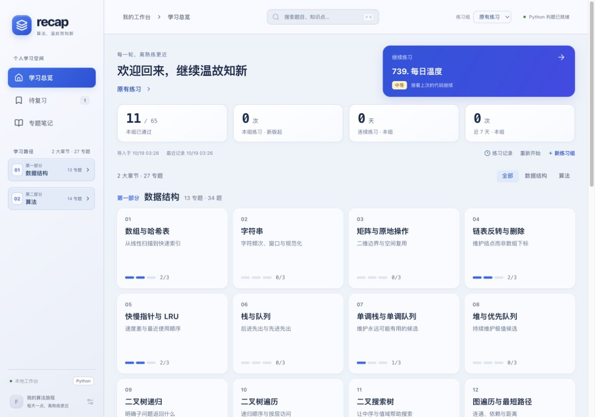
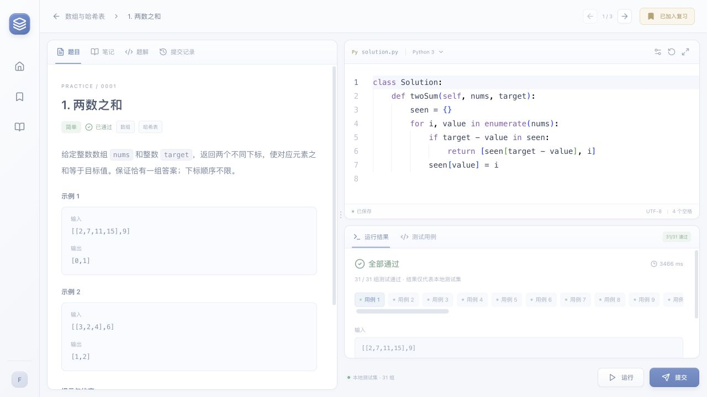

# LeetCode Recap

把自己的算法笔记变成可以阅读、编写 Python、运行和复习的本地工作台。



以“数据结构”和“算法”两个大章节组织专题。做题页采用左右分屏：左侧题目、笔记、题解与提交记录，右侧 Python 编辑器和测试结果。界面采用 iOS 风格与拟物细节，以深蓝主视觉、亮蓝交互和深色正文建立清晰层次。

## Quickstart

需要 **Python 3.9+、Node.js 22.12+、npm、Docker Desktop / OrbStack**。先启动 Docker。

```sh
./scripts/setup.sh
./scripts/start.sh
```

浏览器打开 **http://127.0.0.1:8765**。安装完成后，每次使用只需要启动 Docker，再执行 `./scripts/start.sh`。

```sh
./scripts/stop.sh                 # 停止本地服务
RECAP_PORT=8766 ./scripts/start.sh # 自定义端口（先停止旧服务）
```

首次准备会安装依赖、构建前端和本地 Python 判题镜像，需要联网。平时题面、编辑器、笔记、判题与记录均在本机运行。程序只监听本机回环地址，无需注册。

## 内容规模

**2 个大章节 · 27 个专题 · 66 道可判题题目 · 30 篇中文笔记 · 1,997 组提交测试**。数据结构包含 13 个专题，算法包含 14 个专题；每个专题精选 1–4 道题，同组跨专题重复出现的题目共享进度。「42. 接雨水」同时收录在相向双指针与单调栈专题。保留其余原题链接，作为延伸阅读。

## 可以做什么

- 按数据结构／算法两大章节学习专题，查看中文笔记、图解和延伸阅读；30 篇笔记支持中文／原文切换，348 个相关题目链接标题已汉化。
- 顶部搜索随屏幕宽度伸展；点击面包屑可返回学习总览或当前专题所属大章节，并保留练习组。手机端搜索独占一行。
- 在题目标题下方打开 `leetcode.cn` 中文原题或 `leetcode.com` 国际站原题，使用新标签页保留当前练习。
- 在 Monaco 编辑器中使用 LeetCode 风格的 `class Solution` 编写 Python；支持变量、成员方法和函数参数提示，节点结构由系统提供。
- “运行”检查样例或自定义参数，“提交”检查项目维护的完整测试集。
- 查看通过数量、实际与预期输出、调试输出、错误信息和耗时。
- 上下拖动编辑器与运行结果之间的横条调整高度，底部运行与提交按钮保持可用；支持方向键、双击复位，并在当前浏览器记住比例。
- 输入与输出使用紧凑 JSON；长结果默认折叠，可展开查看或复制完整内容。
- 语法与运行错误显示代码行号，可点击跳转到编辑器；修改代码后清除旧错误标记。
- 左侧“练习组”栏列出进行中的练习及完成数量，点击组名切换，点击加号新建。默认全部题目，也可自选章节；组内跨章节共享同题代码与通过状态。
- “重新开始”创建空白新轮次，保留旧组草稿与历史。归档只收起练习组，题单、代码、进度及时间记录均保留；从左侧“已归档”进入，点击“恢复”即可放回列表。做题页点击练习组名称也能打开管理。
- 从已有组复制题单、草稿、完成状态和复习标记，复制后两组独立；原提交与练习历史保留在来源组。
- 在组管理中原地编辑名称、章节与具体题目；移出题目保留其记录，再加入可恢复。支持标记完成、标记未完成及恢复自动判断；手动标记不会新增判题记录，再次提交通过会自动完成。
- 主页显示本组通过题数、练习次数、连续练习天数、近 7 天次数，以及创建和最近练习时间。
- 每次进入题目记录时间；运行与提交均保留当时的代码、结果和时间。刷新沿用当前练习，离开再进入新增一次。
- 查看提交历史并恢复代码、标记待复习、继续上次练习。
- 支持数组、链表、二叉树，以及 LRU、Trie 等设计类题目。



## 做题与输入

只需实现编辑器中的方法，不必解析标准输入或打印最终答案。常用 `typing` 类型、`ListNode` 和 `TreeNode` 由运行环境提供。具体方法与参数顺序以每题模板为准。

输入时会自动显示补全列表，也可用 `Ctrl+Space` 手动触发，用 `Tab` 接受建议。补全由本机后端静态分析当前代码，不会执行代码；后端不可用时会降级为当前文档中的名称提示。它提供编写辅助，不进行完整的类型检查。

运行或提交出现语法、运行时异常时，错误详情提供行号入口，点击即可定位到编辑器的红色标记；能可靠确定时同时显示列号。行号对应本次执行的原始代码，编辑后会清除旧标记。历史提交需先恢复同一份代码才能定位；答案错误和超时等无法确定位置的结果不会猜测行号。

自定义输入是 **JSON 参数数组**，不是 Python 语法。例如：

```json
[[2, 7, 11, 15], 9]
```

表示方法接收两个参数 `nums` 与 `target`。二叉树用层序数组和 `null` 表示空节点，普通链表用数组表示。环形链表参数使用 `{"values":[3,2,0,-4],"pos":1}`，`pos` 是尾节点连接的位置，`-1` 表示无环。设计题使用 `[操作名称数组, 参数数组]`，首项为构造函数。

“运行”自定义输入时，系统使用参考实现计算预期值；输入需符合题目约束。提交时的“通过”表示通过本项目测试集，不代表 LeetCode 官方判题结果。耗时包含当前实现的执行测量开销，适合定位问题，不作性能排名。

## 可选：同步提交到 LeetCode.cn

做题页可勾选“同步到 LeetCode.cn”。点击提交时，会先把同一次提交的代码写入 Chrome 中对应原题的 Python3 编辑器，读回确认一致后，再提交到已登录的力扣中国账号。“打开力扣编辑器”可回到实际同步的标签页继续调试。本地和原站的判题结果分别显示，原站失败不影响本地草稿与记录；“运行”只在本地执行。

这需要加载项目的 `browser-extension/` Chrome 联动扩展；已安装旧版时需重新加载扩展和本地练习页。Codex 已连接 Chrome 不代表本地网站已连接。默认关闭，未检测到支持编辑器同步的项目扩展时不可勾选。同步会覆盖原题编辑器中的 Python3 代码；无法确认编辑器、语言或代码一致时停止原站提交。安装、权限与接口兼容性说明见 [浏览器联动](browser-extension/README.md)。遇到登录、验证码或未确认结果时，到原站处理；扩展不会自动重复提交。官方提交历史保存在 LeetCode 账号中。

## 项目结构

```text
frontend/              React + TypeScript + Monaco 界面
backend/               FastAPI API、SQLite 持久化与 Docker 判题
backend/judge/         Python 镜像与结构适配器
browser-extension/     可选的 Chrome 原站提交联动
data/catalog.json      章节、题目、参考解及项目测试集
data/content/          导入的博客笔记与图片
data/translations/     可维护的中文笔记与源文件摘要
scripts/               安装、启动、停止、导入工具
docs/                  数据维护与验证说明
runtime/               本机草稿、进度、提交记录与日志（Git 忽略）
```

## 开发与验证

`make test` 可一并运行内容检查、导入回归、前后端测试与构建。

```sh
./scripts/dev.sh                       # API + 前端开发服务
.venv/bin/python scripts/check_content.py
.venv/bin/python scripts/test_import_notes.py
.venv/bin/python scripts/test_catalog.py
.venv/bin/python -m pytest backend/tests -q
npm --prefix frontend test
npm --prefix browser-extension test
npm --prefix frontend run build
.venv/bin/python -m backend.validate_catalog --include-examples --workers 2 # 全题库真实 Docker 回归
```

生产预览由 FastAPI 直接提供构建后的前端；开发环境由 Vite 转发 `/api` 和 `/content` 到本机后端。开发服务与生产服务使用同一默认后端端口，切换前先停止现有服务。

运行 HTTP 与真实判题的组合验证：`.venv/bin/python scripts/smoke.py`。它使用临时数据库，不修改个人进度。

导入笔记中保留的外部链接和远程图片需要联网。

完整测试范围与验证结果见 [验证记录](docs/VERIFICATION.md)。接口可在本地 [API 文档](http://127.0.0.1:8765/api/docs) 查看。

## 更新笔记与扩充题库

原始笔记来自相邻博客仓库 `../blog/fenglyu-doc-site-v1/docs/leetcode/topics`，已复制进项目，因此日常启动无需博客项目存在。更新方式见 [题库维护](docs/CONTENT.md)。

章节分类与补充题目的参考来源包含 [灵茶山艾府基础算法精讲题单](https://github.com/EndlessCheng/codeforces-go/blob/master/leetcode/README.md) 和 [算法模板目录](https://github.com/EndlessCheng/codeforces-go)。每题保留原题链接；新增题面为本项目的简洁重述，测试数据为项目自建。原始博客笔记保留作者内容与原有引用。此项目用于个人复习，与参考网站及 LeetCode 无隶属关系。

## 本地数据与 Git 回滚

记录默认保存在 **`runtime/recap.sqlite3`**，可以通过 `RECAP_DB_PATH` 修改位置：

| 记录 | 保存位置与内容 |
| --- | --- |
| 练习组与题单 | SQLite 的 `practice_groups` 与 `practice_group_problems`；固定组内题单，新增组不清空旧组 |
| 当前代码草稿 | SQLite 的 `progress.draft`，按练习组与题目自动保存；停止输入约 650 毫秒后写入 |
| 运行与提交历史 | SQLite 的 `submissions`，通过 `kind` 区分运行、提交，保留完整代码、结果、请求和完成时间 |
| 单次练习与日期统计 | SQLite 的 `practice_sessions` 与 `practice_days`；仅浏览也留时间，修改、运行或提交后才计入练习次数 |
| 通过、复习、继续学习 | 组内 `progress`、`practice_groups.last_problem_id`；`settings` 记录最后选中的组 |
| 尚未写入数据库的草稿 | 当前浏览器的 localStorage，键名为 `recap:recovery:<练习组ID>:<题目ID>`；保存成功后清除对应缓存 |
| 编辑器与结果区高度 | 当前浏览器的 localStorage，键名为 `recap:layout:editor-share`；跨题目与刷新复用 |

“运行”与“提交”分别生成执行历史，自动完成状态以通过本项目完整测试集的提交为准。一次练习中的多次执行只计一次练习，统计全部基于当前组。时间保存为 UTC，显示及自然日统计使用 `Asia/Singapore`（UTC+8）。草稿不是逐题保存的 `.py` 文件，Git 也不跟踪这些个人记录。

复制组会继承当前完成进度，也可在“首页 → 练习组名称 → 编辑”中手动调整。存在手动标记时，统计显示“已完成 · 含手动”，与判题通过记录区分；调整历史与时间保存在 `progress_adjustments`。编辑题单不会更改组 ID、创建时间或删除历史，多处同时编辑时会提示冲突。复制组的练习次数与连续天数从创建后独立计算。

升级时自动把旧数据归入“原有练习”，保留代码、状态和原提交时间，并在数据库旁生成 `*-before-practice-groups-*.sqlite3` 一致性备份。旧版没有记录每次练习的开始时间，因此练习次数与连续天数从升级后开始统计。旧浏览器恢复草稿只迁入原有组。各组通过 URL 中的 `group` 标识固定，迟到的自动保存或判题结果仍归原组。

云部署、数据库与 Google 登录的后续取舍见 [多组练习与云端部署方案](docs/PRACTICE_AND_CLOUD_PLAN.md)。当前仍是本地应用，尚未接入云服务与 Google 登录。

备份时先停止服务，再复制整个 `runtime/` 文件夹；恢复时停止服务并放回备份。重建前端、更新题库和代码回滚不会清除数据库中已经保存的个人记录。

```sh
git log --oneline                      # 查看阶段性提交
git diff                               # 查看未提交的代码变化
git restore --source=<commit> -- <path> # 从某次提交恢复指定文件
```

回滚前保留自己尚未提交的修改。修改判题镜像后，重新运行 `docker build -t recap-python:local backend/judge`；修改前端后重新构建并重启服务。Git 不跟踪本机进度、虚拟环境和依赖目录。

## 常见问题

**提示判题不可用**：启动 Docker / OrbStack，确认 `docker info` 能连接，并重新构建 `recap-python:local` 镜像。应用不会把提交代码直接放到宿主机执行。

**端口占用或启动失败**：查看 `runtime/server.log`，先运行停止脚本，或换一个 `RECAP_PORT`。不要关闭不属于本项目的进程。

**修改了题库却未显示**：重启后端；源笔记更新需要先执行导入命令。

**运行很久或输出太多**：判题容器有 CPU、内存、进程、输出与时间限制，超过限制会返回对应错误。容器禁用网络、只读根文件系统、不挂载个人文件。该环境定位为个人本机练习，不面向不受信任用户开放公网服务。
