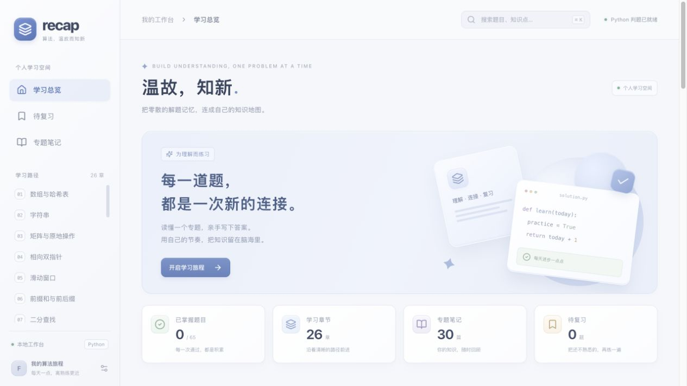

# LeetCode Recap

把自己的算法笔记变成可以阅读、编写 Python、运行和复习的本地工作台。



做题页采用左右分屏：左侧题目、笔记、题解与提交记录，右侧 Python 编辑器和测试结果。界面采用浅色 iOS 风格与柔和拟物细节。

## Quickstart

需要 **Python 3.9+、Node.js 22.12+、npm、Docker Desktop / OrbStack**。先启动 Docker。

```sh
./scripts/setup.sh
./scripts/start.sh
```

浏览器打开 **http://127.0.0.1:8765**。安装完成后，每次使用只需要启动 Docker，再执行 `./scripts/start.sh`。

```sh
./scripts/stop.sh                 # 停止本地服务
RECAP_PORT=8766 ./scripts/start.sh # 自定义端口（先停止旧服务）
```

首次准备会安装依赖、构建前端和本地 Python 判题镜像，需要联网。平时题面、编辑器、笔记、判题与记录均在本机运行。程序只监听本机回环地址，无需注册。

## 内容规模

**26 个学习章节 · 65 道可判题题目 · 30 篇原始笔记 · 1,934 组提交测试**。每章精选 2–3 道题，跨章节重复出现的题目共享进度。保留其余原题链接，作为延伸阅读。

## 可以做什么

- 按知识点学习章节，查看原始博客笔记、图解和延伸阅读。
- 在 Monaco 编辑器中使用 LeetCode 风格的 `class Solution` 编写 Python；节点结构由系统提供。
- “运行”检查样例或自定义参数，“提交”检查项目维护的完整测试集。
- 查看通过数量、实际与预期输出、调试输出、错误信息和耗时。
- 自动保存草稿；跨章节共享同题代码与通过状态。
- 查看提交历史并恢复代码、标记待复习、继续上次练习。
- 支持数组、链表、二叉树，以及 LRU、Trie 等设计类题目。

## 做题与输入

只需实现编辑器中的方法，不必解析标准输入或打印最终答案。常用 `typing` 类型、`ListNode` 和 `TreeNode` 由运行环境提供。具体方法与参数顺序以每题模板为准。

自定义输入是 **JSON 参数数组**，不是 Python 语法。例如：

```json
[[2, 7, 11, 15], 9]
```

表示方法接收两个参数 `nums` 与 `target`。二叉树用层序数组和 `null` 表示空节点，普通链表用数组表示。环形链表参数使用 `{"values":[3,2,0,-4],"pos":1}`，`pos` 是尾节点连接的位置，`-1` 表示无环。设计题使用 `[操作名称数组, 参数数组]`，首项为构造函数。

“运行”自定义输入时，系统使用参考实现计算预期值；输入需符合题目约束。提交时的“通过”表示通过本项目测试集，不代表 LeetCode 官方判题结果。耗时包含当前实现的执行测量开销，适合定位问题，不作性能排名。

## 项目结构

```text
frontend/              React + TypeScript + Monaco 界面
backend/               FastAPI API、SQLite 持久化与 Docker 判题
backend/judge/         Python 镜像与结构适配器
data/catalog.json      章节、题目、参考解及项目测试集
data/content/          导入的博客笔记与图片
scripts/               安装、启动、停止、导入工具
docs/                  数据维护与验证说明
runtime/               本机草稿、进度、提交记录与日志（Git 忽略）
```

## 开发与验证

```sh
./scripts/dev.sh                       # API + 前端开发服务
.venv/bin/python scripts/check_content.py
.venv/bin/python -m pytest backend/tests -q
npm --prefix frontend test
npm --prefix frontend run build
.venv/bin/python -m backend.validate_catalog --include-examples --workers 2 # 全题库真实 Docker 回归
```

生产预览由 FastAPI 直接提供构建后的前端；开发环境由 Vite 转发 `/api` 和 `/content` 到本机后端。开发服务与生产服务使用同一默认后端端口，切换前先停止现有服务。

运行 HTTP 与真实判题的组合验证：`.venv/bin/python scripts/smoke.py`。它使用临时数据库，不修改个人进度。

导入笔记中保留的外部链接和远程图片需要联网。

完整测试范围与验证结果见 [验证记录](docs/VERIFICATION.md)。接口可在本地 [API 文档](http://127.0.0.1:8765/api/docs) 查看。

## 更新笔记与扩充题库

原始笔记来自相邻博客仓库 `../blog/fenglyu-doc-site-v1/docs/leetcode/topics`，已复制进项目，因此日常启动无需博客项目存在。更新方式见 [题库维护](docs/CONTENT.md)。

章节分类与补充题目的参考来源包含 [灵茶山艾府基础算法精讲题单](https://github.com/EndlessCheng/codeforces-go/blob/master/leetcode/README.md) 和 [算法模板目录](https://github.com/EndlessCheng/codeforces-go)。每题保留原题链接；新增题面为本项目的简洁重述，测试数据为项目自建。原始博客笔记保留作者内容与原有引用。此项目用于个人复习，与参考网站及 LeetCode 无隶属关系。

## 本地数据与 Git 回滚

草稿、复习标记、提交和进度存放在 `runtime/` 下 SQLite 数据库中。备份时先停止服务，再复制整个 `runtime/` 文件夹；恢复时停止服务并放回备份。重建前端与更新题库不会清除个人记录。

```sh
git log --oneline                      # 查看阶段性提交
git diff                               # 查看未提交的代码变化
git restore --source=<commit> -- <path> # 从某次提交恢复指定文件
```

回滚前保留自己尚未提交的修改。修改判题镜像后，重新运行 `docker build -t recap-python:local backend/judge`；修改前端后重新构建并重启服务。Git 不跟踪本机进度、虚拟环境和依赖目录。

## 常见问题

**提示判题不可用**：启动 Docker / OrbStack，确认 `docker info` 能连接，并重新构建 `recap-python:local` 镜像。应用不会把提交代码直接放到宿主机执行。

**端口占用或启动失败**：查看 `runtime/server.log`，先运行停止脚本，或换一个 `RECAP_PORT`。不要关闭不属于本项目的进程。

**修改了题库却未显示**：重启后端；源笔记更新需要先执行导入命令。

**运行很久或输出太多**：判题容器有 CPU、内存、进程、输出与时间限制，超过限制会返回对应错误。容器禁用网络、只读根文件系统、不挂载个人文件。该环境定位为个人本机练习，不面向不受信任用户开放公网服务。
