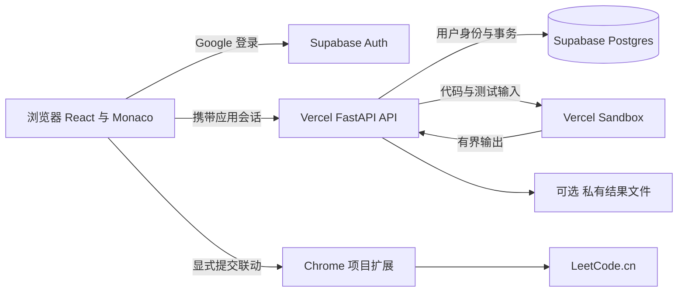

# 多组练习与云端部署方案

日期：2026-10-19。状态：本地多组练习、练习时间记录与紧凑首页已实现。云端部署、Postgres 迁移和 Google 登录保留为后续提案，本轮按用户要求只交付前两部分。

目标是把个人练习从一份全局进度扩展为可以随时切换的多轮复习，在主页显示当前轮次、时间与学习概况；后续可通过 Google 登录在不同设备继续。已确认：练习组默认包含全部题目，也可以自选章节。云端部分以电脑关机后仍能判题作为比较场景，实际部署范围待后续确定。

建议先完成本地多组练习与旧数据迁移，再采用 **Vercel 前端与 FastAPI API + Supabase Postgres 与 Auth + Vercel Sandbox 判题**。上云前先验证现有判题器在 Sandbox 的兼容性、延迟和费用；通过后再锁定平台。继续保留本地 SQLite 与 Docker 运行方式。

## 练习组与时间记录

### 创建与切换

- 创建组时可填写名称，默认名称为“第 N 轮复习”，默认全题库，也可勾选数据结构、算法及其专题。跨专题重复题目去重，目前全题库为 65 道。
- 保存创建时的题单与题库版本，后续新增题目不悄悄改变旧组的完成分母。更新旧组题单需要显式操作；原题 ID 保持稳定。
- 每组独立保存草稿、通过状态、复习标记、最后练习题和历史。同题在同一组的不同专题中共享这些记录。
- 切换组后回到该组上次的位置。组可以命名、归档、恢复；首版不提供直接删除历史的操作。
- “重新开始”按原组题单创建一个空白新组，使用初始代码模板；保留原组所有内容。需要参考旧代码时，从历史选择并恢复到当前组，记录来源。
- 任意时候可以从旧组继续；完成全部题目也不会自动封存或清空。
- 支持从旧组复制题单、草稿、当前完成状态和复习标记。新旧组独立，练习与提交历史保留在实际发生的组；新组保留来源关系。
- 支持原地编辑组名、章节与具体题目。移出只改变当前题单和完成分母，不删除原草稿与历史；重新加入恢复。完成标记可显式设为完成、未完成或自动判断，调整保留时间记录；再次提交通过时自动完成，不修改旧判题结果。

### 每次练习记录什么

练习组代表一次复习轮次；单次练习代表在组内连续练习一道题。一次练习可以运行、提交多次，不能把提交次数当作练习次数。

| 对象 | 记录的时间 | 行为 |
| --- | --- | --- |
| 练习组 | 创建、首次实际练习、最后实际练习、归档时间 | 每组各自维护 |
| 单次练习 | 打开、首次活动、最后活动、结束时间 | 刷新恢复当前练习；离开后再次进入形成新记录 |
| 草稿 | 最后保存时间、递增版本 | 自动保存只更新当前草稿，不按每个按键复制历史 |
| 运行记录 | 请求、开始执行、结束时间 | 保存代码快照与结果，便于回看调试 |
| 提交记录 | 请求、开始执行、结束时间 | 保留不可变的代码快照与判题结果 |
| 官方提交联动 | 发起、收到结果时间 | 与本项目结果分别保存，未确认不能算官方通过 |

服务端时间为权威时间，统一保存 UTC。界面用账户时区展示完整日期与时间，初始使用 `Asia/Singapore`；“今天”“连续 N 天”“近 7 天”都按这个时区的自然日计算。离线操作可另记客户端发生时间与服务端接收时间，并标明补传。

仅打开或刷新题目也有访问时间；首页的“练习次数”和连续天数只计发生过修改、运行或提交的练习。一次练习计一次，同一次练习的多个提交不重复计数。浏览器异常关闭时以最后活动时间标为中断，不伪造精确结束时间；首版不把页面停留时间称作有效学习时长。

### 防止切组与跨设备串数据

- 路由和所有修改请求显式携带 `group_id`，运行与提交同时绑定 `practice_session_id`，不能依赖服务端一个全局“当前组”。最后选中的组仅是恢复偏好，各标签页仍固定自己的组。
- 切换前先刷新待保存草稿；保存失败时保留带账户、练习组和题目身份的本地恢复缓存。迟到的保存或判题结果仍写入原组。
- 云端草稿使用版本比较更新。同一题在两个设备同时修改时提示冲突，保留两份代码供选择，不按最后到达的请求静默覆盖。
- 练习创建、运行与本项目提交使用请求 ID 去重。官方提交保持现有不自动重试的规则；未知结果需要人工到原站确认。
- 新练习组不会继承旧组的通过状态，也不会覆盖 LeetCode 原站代码；只有显式开启同步并点击提交才使用现有联动功能。

## 主页布局

沿用紧凑四列章节卡片。顶部控制总高度，新增管理内容放入抽屉。

1. **顶部一行**：左侧“欢迎回来”与用户名称、当前练习组选择器；右侧一张紧凑的蓝色“继续练习”卡，显示题目、所属专题与难度。无练习记录时显示“开始本组”。
2. **四张统计卡**：本组已通过 `x / n`、本组练习次数、本组连续练习天数、本组近 7 天练习次数。首版都基于当前组，并标明统计范围。项目没有测验机制，暂不显示“测验通过”。
3. **一条组信息栏**：创建时间、最后练习时间、“新建练习组”“重新开始”“练习记录”。组选择器里可查看各组进度与最后练习时间。
4. **原有两大章节**：数据结构和算法；章节卡的分子、分母都基于当前组题单。自选组不显示没有选中题目的专题。

“管理练习组”抽屉使用紧凑列表，展示名称、题单范围、进度、创建时间、最后练习时间与继续入口。“练习记录”抽屉展示带时间的题目、运行、提交和状态，可筛选组并打开相应代码。移动端统计卡为两列，继续练习卡压缩为一行；不在主页展开长历史。

例如：第一轮通过 20/65，第二轮通过 3/65。选择第二轮后，顶部与章节卡都显示第二轮进度；选择第一轮可继续其第 21 题。两轮练习同一道题的代码互不覆盖。

## 数据模型

以下是逻辑模型，首个阶段在 SQLite 实现，云端使用 Postgres。术语见 [领域用语](../GLOSSARY.md)。

| 表 | 主要内容 |
| --- | --- |
| `profiles` | 内部用户 ID、显示名、统计时区；云端关联 Supabase Auth 用户 |
| `practice_groups` | 所有者、名称、来源组、题库版本、创建和活动时间、归档状态 |
| `practice_group_problems` | 组内去重题单、排序、题目版本；必要的显示快照 |
| `problem_progress` | 组内每题的当前草稿、草稿版本、复习标记、首次通过时间 |
| `practice_sessions` | 所有者、练习组、题目、开始和活动时间、中断或结束状态 |
| `executions` | 练习会话、运行或提交、请求 ID、代码快照、状态、结果与各阶段时间 |
| `official_submissions` | 对应本地执行、官方提交 ID、结果链接、同步和确认状态 |
| `user_preferences` | 最后使用的组等恢复偏好 |

关联需要校验所有者、练习组与题目的一致性。草稿唯一键为组与题目；执行请求 ID 在用户范围内唯一；列表与统计查询按所有者、组、题目和时间建索引。判题通过事实只由服务端判题结果更新，个人完成标记通过单独的显式操作调整，普通草稿写入不能修改这些状态。

本项目提交的通过记录是完成进度的依据。运行和官方联动不增加本组已通过题数；官方成功与否在历史中独立呈现。

### 旧 SQLite 数据迁移

现有 `progress` 按题目保存一份状态，`settings` 只有一份最近题目，`submissions.created_at` 已保存 UTC 时间；访问操作未保存逐次历史，运行也未持久化。

迁移过程先一致性备份，再在事务中创建“原有练习”组，把原有草稿、复习标记、通过状态、最近题目和提交记录完整归入其中。原提交时间与代码不改变。旧数据无法还原的单次练习、开始时间和连续天数保留未知，界面说明统计从新版开始，不拿提交记录虚构练习历史。

保留版本化迁移与导入映射。重复执行导入不重复创建历史。迁移后核对题目数、提交数、每题状态、代码摘要和原始时间；原数据库备份保留至恢复演练通过。旧的浏览器草稿恢复键只迁入对应的原有组，不传播到其他组。

## Cloudflare 与 Vercel 的取舍

截至本方案日期，两家都已有专用沙箱产品。普通云函数可承载 API，但目前的判题实现直接调用 Docker CLI 并依赖 Docker daemon，不能把它作为普通函数直接上线。无论选哪家，都要抽离判题传输层，并用专用沙箱或独立 Linux 服务执行代码。

| 方面 | Cloudflare | Vercel |
| --- | --- | --- |
| 当前 React/Vite 前端 | Workers Static Assets 可部署现有 SPA | 可部署现有 SPA，无需改为 Next.js |
| 当前 FastAPI 与 Jedi 补全 | Python Workers 有不同运行时约束；Containers 更贴近现有 Linux 环境 | Python Functions 原生承载 ASGI/FastAPI，较容易保留 API 与补全 |
| Python 判题 | Workers 调度 Containers/Sandboxes；需 Workers Paid，增加调度和镜像适配 | API 调用 Vercel Sandbox；有 Python SDK，适配现有执行协议 |
| 数据库 | D1 适合全 Cloudflare 路线，也能外接 Postgres | 使用外部 Postgres 等持久化服务 |
| Google 登录 | 可接 Supabase Auth，或自己实现 OIDC；D1 本身不管理登录 | 同样可接 Supabase Auth |
| 主要代价 | 若使用 D1，要改持久化访问方式并单独解决身份系统；Containers 有平台调度配置 | Functions 与 Sandbox 分别受配额约束；付费后需按实际用量估算 |
| 更适合 | 已经采用 Cloudflare 体系，希望集中在 Workers/D1/R2 的项目 | 当前 Python API、个人使用、优先减少运维的项目 |

依据：[Cloudflare 静态资源](https://developers.cloudflare.com/workers/static-assets/)、[Cloudflare 沙箱及付费要求](https://developers.cloudflare.com/sandbox/)、[Vercel Python/FastAPI](https://vercel.com/docs/functions/runtimes/python)、[Vercel Sandbox](https://vercel.com/docs/sandbox)、[Sandbox Python SDK](https://vercel.com/docs/sandbox/python-sdk-reference)。

推荐 Vercel 的理由是现有 Python API 可以保留，判题有独立沙箱与免费起步额度。它是当前项目的选择建议；若 Sandbox 的兼容性或实测延迟不达标，改为独立 Linux 判题服务，数据库与前端无需同时迁移。

## 数据库和文件存储

| 选择 | 优点 | 本项目的取舍 |
| --- | --- | --- |
| 本地 SQLite | 简单，复用当前实现，无外部服务 | 保留给本地运行；不能把文件放在 Vercel 函数临时目录作为持久数据库 |
| Cloudflare D1 | SQLite 语义，按用量计费，适合 Workers | 个人规模足够；现有 `sqlite3` 文件连接不能直接替换为 D1，仍需适配访问层；登录另接 |
| Supabase Postgres + Auth | 关系模型、事务、行级权限与 Google 登录集中管理；可导出标准 Postgres 数据 | 推荐，降低身份与数据两套服务的整合成本 |
| 其他托管 Postgres | 标准数据库，保留迁移能力 | 可以替换 Supabase DB，但需另外选择或维护登录服务 |

不能使用云函数的本地文件充当永久 SQLite 存储，见 [Vercel SQLite 说明](https://vercel.com/kb/guide/is-sqlite-supported-in-vercel)。D1 免费层目前含每日 500 万读行、10 万写行及总计 5 GB 存储，个人使用足够，但这些额度不能消除运行时和登录的适配工作，见 [D1 定价](https://developers.cloudflare.com/d1/platform/pricing/)。

### 各种数据放在哪里

- **题目、中文笔记、图片**：继续用 Git 管理，以版本发布。当前笔记图片约 15 MB，原始题库约 4.9 MB，无需先建设内容管理系统。公开前端只发布题面和允许展示的内容；完整测试集与参考解留在后端发布包。
- **练习组、草稿、活动时间、代码快照、状态与结果摘要**：存 Postgres，JSON 结果用结构化字段或 JSONB，代码用文本。
- **大型输出和调试详情**：必要时放 Supabase 私有 Storage，数据库存引用，使用受权下载；代码与结果摘要不依赖输出文件存在。首版不自动删除历史，输出大小需限制并明确显示截断状态。
- **本地未同步草稿**：浏览器缓存按用户、组、题目隔离，仅作恢复副本。退出账户后不能被另一账户读取或自动上传。
- **登录会话**：由 Supabase Auth 管理。应用没有 Google 密码；Google Client Secret、数据库管理密钥、Sandbox 凭据仅放服务端秘密配置。
- **LeetCode 登录**：继续只在用户 Chrome 中使用原站会话；云端数据库不保存力扣 Cookie。

免费数据库要增加定期逻辑导出和恢复演练，备份放在独立的私有位置。上云时一次性导入本地数据并绑定已授权账户，保留源备份；首版不建设本地 SQLite 与云端同时写入的双向同步系统。上线后跨设备以云端数据为准，离线仅保留待同步草稿。

## Google 登录与个人访问范围

采用 Supabase Auth 的 Google OAuth 登录，仅申请身份、邮箱和头像所需的基础范围。Google 负责身份认证；Supabase 管理应用会话和刷新；项目负责确认该用户可以访问个人练习。

1. 创建 Google OAuth Web 客户端，在 Google 配置 Supabase 提供的准确回调地址；在 Supabase 配置正式站与本地开发的应用回调白名单。这两组回调地址用途不同。
2. 前端采用 OAuth PKCE，回调完成后由 SDK 管理会话；API 验证 Supabase JWT 的签名、颁发者、受众、有效期和用户身份。回调使用真实路径 `/auth/callback`，不能把 OAuth 回调直接当作现有 hash 做题路由。
3. 个人使用只允许预先指定的账户。初次身份绑定核对受信任的 Google 身份，之后使用 Supabase 用户 ID 做所有权检查；不采用“第一个登录的人就是管理员”的规则。
4. 数据表开启 RLS，按 `auth.uid()` 与所有者控制查询及写入，并加入个人账户许可条件。API 同样检查，不能只在页面隐藏入口。用户身份来自已验证会话，不能信任请求中的 `user_id`。
5. 数据访问应保留用户令牌上下文，让 RLS 生效；涉及多表更新的业务由受权数据库函数或事务完成。若使用直连数据库，使用受限角色与事务内身份上下文，不能误以为管理连接自动受 RLS 保护。
6. Google Client Secret 只交给 Supabase 的服务器端配置。前端只放可公开的项目 URL 与 publishable key；数据库 secret/service-role 密钥不能进入前端或判题沙箱。首版不申请 Google API 离线访问，不保存 Google provider refresh token。
7. 退出时停止刷新并清理本机账户会话、个人查询缓存；未同步草稿需先保存或导出，再清理账户隔离缓存。开发、预览与生产分开配置，预览不自动读写生产个人记录。

Google 的稳定身份来自 `sub`，邮箱用于显示与预先授权核对，不作为永久主键。依据：[Google 身份字段](https://developers.google.com/identity/openid-connect/openid-connect)、[Supabase Google 配置与 PKCE](https://supabase.com/docs/guides/auth/social-login/auth-google)、[RLS 与管理密钥的绕过行为](https://supabase.com/docs/guides/database/postgres/row-level-security)。

## 推荐云端结构

判题沙箱只接收本次需要的题目适配信息、代码和测试数据，不接收数据库或 Google 密钥。默认禁用出网，设置进程、内存、CPU、时间与输出限制，任务结束销毁；每任务独立环境，避免前一次代码或文件影响后一次。继续使用 CPython 3.12 与现有错误定位、比较规则、节点适配器和测试集。

先抽出统一执行接口，保留 `DockerJudge` 并新增 `SandboxJudge`，让云端传输方式不侵入题目逻辑。提交先持久化请求 ID 和代码快照，再调用沙箱；结果通过同一 ID 更新。第一版在有界函数请求内等待执行完成，平台失败则保留明确的中断状态；不依赖函数返回后继续后台工作。若实测需要长任务，再引入持久队列与状态轮询。

同样在 API 保留 Jedi 补全，不能因为前端已上线而丢失变量提示。将现有仅允许 localhost 的中间件改成明确的本地/云端模式；云端强制认证和指定来源。草稿、历史等个人 API 不作公共 CDN 缓存。

现有联动扩展只接受本机来源。上线前必须同时调整 manifest、content script、协议校验和 background sender 校验，只加入确定的正式 HTTPS 域名；不能开放全部 `vercel.app` 或任意网站。Chrome 原站登录与 Google 应用登录分别管理。手机或未安装扩展的设备仍可云端判题，原站联动显示不可用。

## 费用与运行边界

价格为 2026-10-19 查询的公开方案，不含域名、税费和超额用量。

| 项目 | 目前公开额度或起点 | 对个人项目的影响 |
| --- | --- | --- |
| Vercel Hobby | 适用于个人非商业用途；Functions 等各有配额 | 当前用途匹配，需关注 API、补全和静态流量用量 |
| Vercel Sandbox Hobby | 每月 5 小时 Active CPU、420 GB-hours 内存、5,000 次创建 | 可用于试运行；运行、自定义输入参考解及提交都会消耗，不能只数提交按钮次数；超额暂停创建 |
| Supabase Free | 500 MB 数据库、1 GB 文件存储；不活跃一周可能暂停 | 起步足够评估，长期使用需接受恢复等待并维护独立导出 |
| Supabase Pro | 每月 25 美元起，含首个项目及相应计算额度 | 需要长期可用和托管日备份时再升级 |
| Cloudflare Containers | Workers Paid 每月 5 美元起，容器和调度按额度与用量计费 | Cloudflare 云判题不是纯免费静态托管 |

来源：[Vercel Hobby](https://vercel.com/docs/plans/hobby)、[Vercel Sandbox 配额](https://vercel.com/docs/sandbox/pricing)、[Supabase 定价](https://supabase.com/pricing)、[Supabase 备份](https://supabase.com/docs/guides/platform/backups)、[Cloudflare Containers 定价](https://developers.cloudflare.com/containers/platform/pricing/)。

推荐先用免费方案实测，不能承诺永久零费用或免费层始终在线。若不希望承担 Supabase 暂停的影响，可升级付费数据库；若云沙箱实测不合适，独立 Linux 判题是备选，其机器价格需要确定供应商后再比较。

## 实施顺序与验收

1. **本地多组练习**：版本化迁移 SQLite、组与会话 API、带组身份的草稿/历史/路由、时间记录；旧数据先归入原有组。
2. **紧凑首页**：组选择、继续练习、四项统计、时间信息、管理与记录抽屉；保留目前章节密度。
3. **云端判题验证**：用临时数据验证 Sandbox 执行现有协议；覆盖普通题、链表、树、设计题、原地修改、Jedi 补全、错误行号、超时和大输出。记录冷/热延迟与 CPU、内存、创建次数，成功后再决定正式云端执行器。
4. **身份与持久化**：接入 Supabase Google Auth、个人身份许可、RLS 与 Postgres；开发环境先导入测试数据，测试跨用户拒绝和跨设备冲突。
5. **部署与导入**：配置正式域名、回调和服务端密钥，备份并幂等导入个人数据，更新 Chrome 扩展来源，完成备份恢复演练后切换云端为主。

验收必须包含：

- A 组通过一道题，B 组仍未通过；同一题的两份草稿独立，组内跨专题共享正常。
- A 组提交后切 B 组，A 的迟到结果及自动保存不会写进 B。
- 重新开始创建新组，旧组的代码、通过状态、官方结果与原始时间仍可查询。
- 刷新不重复计算一次练习；多次提交不增加单次练习计数；跨午夜和时区统计符合定义。
- 迁移前后代码摘要、提交数和时间一致，重复导入无重复数据，不伪造缺失旧时间。
- 手机与电脑可恢复同一组；并发修改保留冲突版本；过期登录不会把草稿写入其他账户。
- 未授权账户不能读写个人记录或触发判题，数据库与 API 两层都验证；预览部署不串生产数据。
- 判题、补全、错误定位与当前题库回归通过；超额或平台故障时保留代码与请求记录。
- 个人记录可导出并恢复；Chrome 联动只在明确的正式域名与已授权浏览器中工作。

本轮已交付本地多组练习与首页，云端部分仅形成方案。正式域名、云服务账户、月度预算与生产密钥在进入部署阶段时确定。
